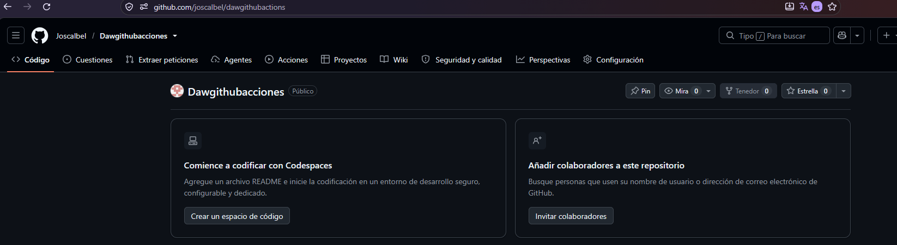

# Projecte Pràctic: JavaScript & Git Flow

Aquest repositori conté una pràctica de desenvolupament web col·laboratiu utilitzant **JavaScript** i la metodologia de control de versions **Git Flow** mitjançant l'ús de comandos estàndard de Git en entorn Windows (Git Bash).

---

## 👥 Apartat 1: Introducció Teòrica

### Què és Git i Git Flow?
* **Git**: Sistema de control de versions distribuït que permet registrar l'historial de canvis d'un projecte i treballar en equip de manera sincronitzada.
* **Git Flow**: És un model d'abstracció de branques per a Git que defineix una estructura estricta de branques dissenyada al voltant del cicle de llançament del programari.

### Per què l'hem utilitzat?
* **Organització clara**: Separa clarament el codi en producció (`main`), el codi en desenvolupament (`develop`), les noves funcionalitats (`feature/`), els llançaments (`release/`) i les correccions urgents (`hotfix/`).
* **Treball en equip**: Evita trepitjar el codi dels companys gràcies a l'ús de branques independents i pull requests / merges controlats.

---

## 🚀 Apartat 2: Procés Pas a Pas i Flux de Treball

A continuació es detalla el flux de treball seguit pel equip de desenvolupament (Rol d'Usuari 1, Usuari 2 i Usuari 3):

### 1. Inicialització (Usuari 1)
Creació del repositori base, configuració de col·laboradors i pujada de l'estructura inicial (Boilerplate HTML/JS).
```bash
git checkout -b develop
git add index.html
git commit -m "usuari 1: afegida estructura inicial i capçalera del projecte"
git push origin main
git push origin develop
```

## Feature Contingut HTML
```bash
git checkout -b feature/contingutHTML develop
git commit -m "usuari 2: implementada la seccio de modificar contingut HTML"
git checkout develop
git merge feature/contingutHTML
```
## Feature Atributs HTML
```bash
git checkout -b feature/atributsHTML develop
git commit -m "usuari 2: implementada la seccio de modificar atributs HTML"
git checkout develop
git merge feature/atributsHTML
```
## Feature Estils CSS
```bash
git checkout -b feature/estilsCSS develop
git commit -m "usuari 3: afegida la seccio de modificar estils CSS"
git checkout develop
git merge feature/estilsCSS
git push origin develop
```
## Gestió de Versions i Release (Usuari 3)
```bash
git checkout -b release/v1.0 develop
git checkout main
git merge release/v1.0
git tag v1.0
git checkout develop
git merge release/v1.0
git push origin main develop --tags
```
## Manteniment i Hotfix (Usuari 1)
```bash
git checkout main
git checkout -b hotfix/milloresV_1_0
git commit -m "usuari 1: millores aplicades a la seccio de contingut HTML (hotfix)"
git checkout main
git merge hotfix/milloresV_1_0
git tag -a v1.0.1 -m "Hotfix v1.0.1"
git checkout develop
git merge hotfix/milloresV_1_0
git push origin main develop --tags
```
